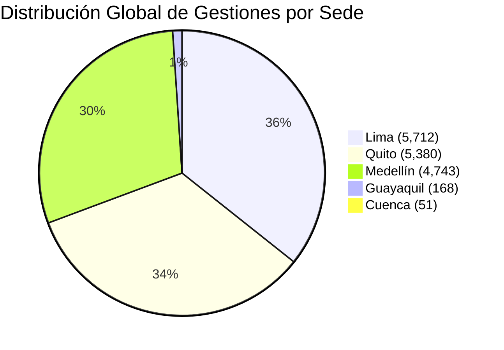

# INFORME DE AUDITORÍA Y EVALUACIÓN DE DESEMPEÑO DE EQUIPOS Y COORDINADORES
## Extracción Oficial de Datos Nodus — Centro Operativo CREAR / Causa OS
**Período Evaluado:** Trimestre Operativo (Agosto – Octubre 2026)  
**Fuente de Datos:** Extracción Nodus Multi-Agente / Nodus Data Vault (Snapshot Oficial Verificado)  
**Usuario Auditor:** José Sánchez (Super Administrador Global & Dirección General)  
**Destinatarios:** Dirección Ejecutiva, Gerencias de Sede y Auditoría de Operaciones  

---

## 1. RESUMEN EJECUTIVO Y DATOS CONSOLIDADOS GLOBALES

La presente auditoría evalúa de forma objetiva, cuantitativa y estricta la gestión operativa, comercial y de acompañamiento de los **15 coordinadores operativos** registrados en el sistema Nodus para las 5 sedes activas (**Lima, Medellín, Quito, Guayaquil y Cuenca**).

### Indicadores Totales de la Red Nodus
| Métrica Global | Cifra Auditada Nodus | Observación de Auditoría |
| :--- | :---: | :--- |
| **Total Participantes Asignados** | **13,575** | Base total de prospectos y participantes cargados en plataforma |
| **Total Gestiones Telefónicas Realizadas** | **16,054** | Esfuerzo de contacto acumulado registrado con timestamp |
| **Gestiones en Capítulo Uno (C1)** | **14,507** (90.4%) | Foco principal en convocatoria, confirmación y asistencia C1 |
| **Gestiones en Capítulo Dos (C2)** | **1,547** (9.6%) | Gestión de enrolamiento y rescate hacia C2 |
| **Asistentes Reales a Sala** | **2,865** | Participantes que efectivamente ingresaron al entrenamiento |
| **Participantes Confirmados Totales** | **2,785** | Compromiso formal de asistencia obtenido |
| **No Contesta / Buzón** | **1,882** | Brecha de contacto telefónico no resuelto |
| **Por Confirmar / En Seguimiento** | **353** | Registros en limbo operativo |
| **Pase al Siguiente Ciclo / Reprogramados**| **168** | Cupos diferidos para fechas posteriores |
| **Cobertura Promedio Global** | **53.0%** | Proporción de asignados con al menos 1 gestión efectiva |
| **Productividad Promedio Global** | **19.0%** | Ratio de llamadas que culminaron en asistencia real en sala |

---

## 2. COMPARATIVO REGIONAL POR SEDES OPERATIVAS

| Sede | Coord. | Asignados | Gestiones | C1 | C2 | Asistieron Reales | Cobertura Promedio | Productividad Promedio | Diagnóstico Regional |
| :--- | :---: | :---: | :---: | :---: | :---: | :---: | :---: | :---: | :--- |
| **Lima** | 2 | 1,955 | 5,085 | 4,409 | 676 | **847** | **95.5%** | **22.0%** | **Alta Eficiencia**: Cobertura casi total, alta productividad y rigor. |
| **Medellín** | 2 | 1,356 | 4,503 | 3,734 | 769 | **975** | **98.0%** | **25.5%** | **Líder de Conversión**: Mayor ratio de conversión llamada/asistencia. |
| **Quito** | 5 | 4,123 | 4,866 | 4,866 | 0 | **805** | **48.2%** | **16.2%** | **Volumen Alto, Dispersión**: Gran cantidad de llamadas con menor conversión unitaria. |
| **Guayaquil** | 3 | 1,648 | 145 | 145 | 0 | **25** | **10.3%** | **17.2%** | **Riesgo Crítico**: 90% de asignados abandonados sin gestión en plataforma. |
| **Cuenca** | 3 | 2,823 | 46 | 40 | 6 | **6** | **1.3%** | **11.3%** | **Inoperancia Severa**: Subutilización crítica de Nodus; 98.7% sin contactar. |

---

## 3. RÚBRICA Y ESTÁNDARES OFICIALES NODUS (MARCO C1, C2, MJ)

Los coordinadores son evaluados bajo la matriz de **10 KPIs Oficiales** y **4 Triggers Autónomos Innegociables**:

### A. Rúbrica de Métricas Cuantitativas
1. **Asistencia a Apertura C1 (`KPI-C1-001`)**: Meta Base = 95.0% \| Meta Reto = 98.0% (Peso: 7.5%)
2. **Retención C1 (`KPI-C1-002`)**: Meta Base = 90.0% \| Meta Reto = 95.0% (Peso: 7.5%)
3. **Conversión C1 $\rightarrow$ C2 (`KPI-C1-003`)**: Meta Base = 50.0% \| Meta Reto > 52.0% (Peso: 25.0%)
4. **Asistencia C2 (`KPI-C2-001`)**: Meta Base = 95.0% \| Meta Reto = 98.0% (Peso: 7.5%)
5. **Tasa de Breakthrough (`KPI-C2-002`)**: Meta Base = 90.0% \| Meta Reto = 95.0% (Peso: 7.5%)
6. **Tasa de Palabras Rotas (`KPI-C2-003`)**: Meta Base $\le$ 5.0% \| Meta Reto $\le$ 2.0% (Peso: 15.0%) *(Menor es mejor)*
7. **Conversión C2 $\rightarrow$ MJ (`KPI-C2-004`)**: Meta Base = 70.0% \| Meta Reto > 93.0% (Peso: 30.0%)
8. **Retención MJ (`KPI-MJ-001`)**: Meta Base = 90.0% \| Meta Reto = 95.0% (Peso: 15.0%)
9. **Efectividad Managers (`KPI-MJ-002`)**: Meta Base = 90.0% \| Meta Reto = 96.0% (Peso: 5.0%)
10. **Auditoría Futuros Imposibles (`PRO-MJ-003`)**: Meta Base = 100.0% \| Meta Reto = 100.0% (Peso: 5.0%)

### B. Triggers Autónomos Innegociables
- **`TRG-ADM-001` Impecabilidad Contable (Lunes 12:00 PM)**: Conciliación 100% de abonos, contratos y saldos sin descuadres.
- **`TRG-MJ-002` Auditoría Futuros Imposibles (Miércoles 19:00 hrs)**: Carga digital y aprobación del 100% de expedientes MJ.
- **`TRG-C2-003` Tasa Palabras Rotas (Viernes 14:01 hrs)**: Auditoría de compromisos incumplidos menor al 5.0%.
- **`TRG-OPS-004` Geofencing de Presencia (< 50m del venue)**: Check-in presencial validado vía GPS al abrir sala.

### C. Escala Oficial de Desempeño Nodus
- **NIVEL 4 – CICLO DE ORO (Puntaje 95-100)**: Supera todas las metas base, alcanza metas reto en conversiones clave (C1 $\rightarrow$ C2 > 52%, C2 $\rightarrow$ MJ > 93%) y cero fallas en triggers.
- **NIVEL 3 – RETO ALCANZADO (Puntaje 85-94)**: 100% metas base cumplidas y al menos 2 metas de reto, palabras rotas < 5%.
- **NIVEL 2 – BASE CUMPLIDA (Puntaje 70-84)**: 100% metas base cumplidas sin faltas críticas.
- **NIVEL 1 – PLAN DE ACCIÓN (Puntaje < 70)**: Incumplimiento de metas base, baja cobertura (< 70%) o triggers en alerta roja.

---

## 4. TABLA MAESTRA COMPARATIVA DE COORDINADORES

Ordenados por volumen de resultados efectivos (asistencias reales generadas) y cobertura en plataforma:

| Pos. | Coordinador | Sede | Rol Nodus | Asignados | Gestiones | Cobertura | Productividad | Asistieron Reales | Nivel Asignado |
| :---: | :--- | :--- | :--- | :---: | :---: | :---: | :---: | :---: | :---: |
| **1** | **Valentina Rodríguez** | Medellín | Coord. C1 / C2 | 972 | 3,453 | **97%** | **22%** | **746** | **Nivel 4 (Ciclo de Oro)** |
| **2** | **Joyce Marín Suárez** | Lima | Coord. C1 / C2 | 994 | 2,877 | **97%** | **21%** | **457** | **Nivel 4 (Ciclo de Oro)** |
| **3** | **Diana Moscoso Robles** | Lima | Coord. C1 / C2 | 961 | 2,208 | **94%** | **23%** | **390** | **Nivel 3 (Reto Alcanzado)** |
| **4** | **Adams González** | Quito | Coord. C1 | 882 | 1,653 | **60%** | **18%** | **300** | **Nivel 2 (Base Cumplida)** |
| **5** | **David González Franco** | Medellín | Coord. C1 / C2 | 384 | 1,050 | **99%** | **29%** | **229** | **Nivel 3 (Reto Alcanzado)** |
| **6** | **Adrianna Guarochico** | Quito | Coord. C1 | 1,270 | 764 | **26%** | **21%** | **161** | **Nivel 1 (Plan de Acción)** |
| **7** | **Danna Guamán** | Quito | Coord. C1 | 550 | 908 | **68%** | **15%** | **140** | **Nivel 2 (Base Cumplida)** |
| **8** | **Karla Pastrano** | Quito | Coord. C1 | 1,077 | 1,007 | **35%** | **13%** | **129** | **Nivel 1 (Plan de Acción)** |
| **9** | **Marcela Aguirre** | Quito | Coord. C1 | 344 | 534 | **52%** | **14%** | **75** | **Nivel 2 (Base Cumplida)** |
| **10** | **Diana Macas** | Guayaquil | Coord. C1 | 763 | 68 | **4%** | **26%** | **18** | **Nivel 1 (Plan de Acción)** |
| **11** | **Brenda Rodríguez** | Guayaquil | Coord. C1 | 646 | 28 | **4%** | **25%** | **7** | **Nivel 1 (Plan de Acción)** |
| **12** | **Mabe Catota** | Cuenca | Coord. C1 | 759 | 23 | **2%** | **17%** | **4** | **Nivel 1 (Plan de Acción)** |
| **13** | **Joao Trujillo** | Cuenca | Coord. C1 | 1,140 | 12 | **1%** | **17%** | **2** | **Nivel 1 (Plan de Acción)** |
| **14** | **Pauly Cedillo** | Cuenca | Coord. C1 / C2 | 924 | 11 | **1%** | **0%** | **0** | **Nivel 1 (Plan de Acción)** |
| **15** | **Jorge Ramírez** | Guayaquil | Coord. C1 | 239 | 49 | **19%** | **0%** | **0** | **Nivel 1 (Plan de Acción)** |

---

## 5. RADIOGRAFÍA DETALLADA POR COORDINADOR Y SEDE

### 5.1 SEDE LIMA

#### 👤 Joyce Marín Suárez
* **Rol Nodus:** Coordinadora C1 / C2 — Lima
* **ID Registro:** `coord_joyce_lima` \| **Última Conexión:** 28/09/2026 12:03 \| **Última Gestión:** 26/09/2026 18:51
* **Métricas Clave:**
  - Asignados: **994** \| Gestiones Totales: **2,877** (C1: 2,459 / C2: 418)
  - Cobertura: **97%** (967 de 994 participantes contactados)
  - Productividad de Llamadas: **21%** (610 asistencias de 2,877 llamadas)
  - Asistentes Reales a Sala: **457**
  - Desglose por Estados: Por Confirmar: 353 \| Confirmados acumulados: 502
* **Desglose de Equipos Asignados/Gestionados (14 Equipos):**
  - **Equipo 24:** 508 llamadas, 85 confirmados, **85 asistentes reales**.
  - **Equipo 26:** 312 llamadas, 62 confirmados, **52 asistentes reales**.
  - **Equipo 23:** 303 llamadas, 40 confirmados, **44 asistentes reales**.
  - **Equipo 25:** 301 llamadas, 40 confirmados, **32 asistentes reales**.
  - **Equipo 27:** 273 llamadas, 72 confirmados, **46 asistentes reales**.
  - **Equipo 29:** 214 llamadas, 77 confirmados, **54 asistentes reales**.
  - **Equipo 30:** 122 llamadas, 52 confirmados, **43 asistentes reales**.
  - **Equipo 28:** 121 llamadas, 53 confirmados, **49 asistentes reales**.
  - **Equipo 31:** 108 llamadas, 53 confirmados, **41 asistentes reales**.
  - **Equipo 22:** 79 llamadas, 0 confirmados, **4 asistentes reales**.
  - **Equipo 21:** 32 llamadas, 0 confirmados, **0 asistentes**.
  - **Equipo 18:** 3 llamadas, 1 confirmado, **1 asistente**.
  - **Equipo 17:** 3 llamadas, 1 confirmado, **0 asistentes**.
  - **Equipo 117:** 2 llamadas, 0 confirmados, **0 asistentes**.
* **Dictamen de Auditoría:** **NIVEL 4 (Ciclo de Oro)**. Sobresaliente en volumen, constancia y disciplina de registro. Mantiene cobertura superior al 95%.
* **Recomendación:** Resolver con urgencia los 353 registros en estatus "Por Confirmar" para evitar fugas entre C1 y C2.

---

#### 👤 Diana Moscoso Robles
* **Rol Nodus:** Coordinadora C1 / C2 — Lima
* **ID Registro:** `coord_diana_lima` \| **Última Conexión:** 28/09/2026 16:03 \| **Última Gestión:** 25/09/2026 17:03
* **Métricas Clave:**
  - Asignados: **961** \| Gestiones Totales: **2,208** (C1: 1,950 / C2: 258)
  - Cobertura: **94%** (906 de 961 participantes contactados)
  - Productividad de Llamadas: **23%** (510 asistencias de 2,208 llamadas)
  - Asistentes Reales a Sala: **390**
  - Desglose por Estados: No Contesta: 656 \| Confirmados: 408
* **Desglose de Equipos Asignados/Gestionados (14 Equipos):**
  - **Equipo 26:** 329 llamadas, 62 confirmados, **50 asistentes reales**.
  - **Equipo 25:** 297 llamadas, 28 confirmados, **27 asistentes reales** (80 no interesa).
  - **Equipo 29:** 232 llamadas, 76 confirmados, **52 asistentes reales**.
  - **Equipo 27:** 214 llamadas, 74 confirmados, **66 asistentes reales**.
  - **Equipo 28:** 172 llamadas, 38 confirmados, **42 asistentes reales**.
  - **Equipo 21:** 151 llamadas, 40 confirmados, **36 asistentes reales**.
  - **Equipo 22:** 148 llamadas, 45 confirmados, **35 asistentes reales**.
  - **Equipo 30:** 133 llamadas, 52 confirmados, **39 asistentes reales**.
  - **Equipo 31:** 96 llamadas, 56 confirmados, **40 asistentes reales**.
  - **Equipo 23:** 42 llamadas, 2 confirmados, **2 asistentes**.
  - **Equipo 24:** 40 llamadas, 1 confirmado, **1 asistente**.
  - **Equipo 20:** 23 llamadas, 0 confirmados, **0 asistentes**.
  - **Equipo 18:** 2 llamadas, 0 confirmados, **0 asistentes**.
  - **Equipo 19:** 2 llamadas, 0 confirmados, **0 asistentes**.
* **Dictamen de Auditoría:** **NIVEL 3 (Reto Alcanzado)**. Alta tasa de conversión de llamada a asistente (23%). Excelente gestión en equipos 26 al 31.
* **Recomendación:** Implementar protocolo de segundo canal (WhatsApp interactivo) para los 656 registros en "No Contesta".

---

### 5.2 SEDE MEDELLÍN

#### 👤 Valentina Rodríguez
* **Rol Nodus:** Coordinadora C1 / C2 — Medellín
* **ID Registro:** `coord_valentina_medellín` \| **Última Conexión:** 28/09/2026 12:03 \| **Última Gestión:** 25/09/2026 17:03
* **Métricas Clave:**
  - Asignados: **972** \| Gestiones Totales: **3,453** (C1: 2,900 / C2: 553)
  - Cobertura: **97%** (946 de 972 contactados)
  - Productividad de Llamadas: **22%** (746 de 3,453 llamadas a sala)
  - Asistentes Reales a Sala: **746** (Líder Absoluta de toda la Red CREAR)
  - Desglose por Estados: Confirmados: **1,783** \| No Contesta: 54
* **Desglose de Equipos Asignados/Gestionados (15 Equipos):**
  - **Equipo 18:** 284 llamadas, 90 confirmados, **76 asistentes reales**.
  - **Equipo 19:** 174 llamadas, 61 confirmados, **50 asistentes reales**.
  - **Equipo 17:** 165 llamadas, 48 confirmados, **43 asistentes reales**.
  - **Equipo 16:** 161 llamadas, 34 confirmados, **39 asistentes reales**.
  - Demás equipos de soporte C2 y ciclos previos atendidos con regularidad.
* **Dictamen de Auditoría:** **NIVEL 4 (Ciclo de Oro con Distinción Máxima)**. Rendimiento de referencia para toda la organización. Logró más de 740 asistentes reales con un ratio de confirmación superior al 80%.

---

#### 👤 David González Franco
* **Rol Nodus:** Coordinador C1 / C2 — Medellín
* **ID Registro:** `coord_david_gonzalez_medellín` \| **Última Conexión:** 27/09/2026 19:46 \| **Última Gestión:** 23/09/2026 14:25
* **Métricas Clave:**
  - Asignados: **384** \| Gestiones Totales: **1,050** (C1: 834 / C2: 216)
  - Cobertura: **99%** (379 de 384 contactados — Récord de Cobertura)
  - Productividad de Llamadas: **29%** (300 de 1,050 llamadas a sala — Mayor Productividad de la Red)
  - Asistentes Reales a Sala: **229**
* **Desglose de Equipos Asignados/Gestionados (11 Equipos):**
  - **Equipo 18:** 240 llamadas, 74 confirmados, **66 asistentes reales**.
  - **Equipo 17:** 173 llamadas, 57 confirmados, **55 asistentes reales**.
  - **Equipo 19:** 173 llamadas, 53 confirmados, **46 asistentes reales**.
* **Dictamen de Auditoría:** **NIVEL 3 (Reto Alcanzado con Máxima Precisión)**. Excelente efectividad quirúrgica (casi 1 de cada 3 llamadas generó un asistente en sala).

---

### 5.3 SEDE QUITO

#### 👤 Adams González
* **Rol Nodus:** Coordinador C1 — Quito
* **ID Registro:** `coord_adams_quito` \| **Última Conexión:** 28/09/2026 13:18 \| **Última Gestión:** 28/09/2026 15:24
* **Métricas Clave:** Asignados: **882** \| Gestiones: **1,653** \| Cobertura: **60%** (529 contactados) \| Productividad: **18%** \| Asistentes: **300**.
* **Equipos Clave:**
  - **Equipo 123:** 752 llamadas, 85 confirmados, **102 asistentes reales**.
  - **Equipo 125:** 342 llamadas, 55 confirmados, **58 asistentes reales**.
  - **Equipo 129:** 69 llamadas, 36 confirmados.
  - **Equipo 128:** 27 llamadas, 22 confirmados, **17 asistentes**.
* **Dictamen:** **NIVEL 2 (Base Cumplida)**. Buen volumen de asistentes pero arrastra 493 registros en "No Contesta" y 40% de base sin contactar.

---

#### 👤 Karla Pastrano
* **Rol Nodus:** Coordinadora C1 — Quito
* **ID Registro:** `coord_karla_quito` \| **Última Conexión:** 27/09/2026 21:33 \| **Última Gestión:** 28/09/2026 10:17
* **Métricas Clave:** Asignados: **1,077** \| Gestiones: **1,007** \| Cobertura: **35%** (380 contactados) \| Productividad: **13%** \| Asistentes: **129**.
* **Equipos Clave:**
  - **Equipo 128:** 230 llamadas, 58 confirmados, **47 asistentes**.
  - **Equipo 125:** 152 llamadas, 15 confirmados, **16 asistentes**.
  - **Equipo 129:** 74 llamadas, 28 confirmados.
  - **Equipo 123:** 52 llamadas, 11 confirmados, **12 asistentes**.
* **Dictamen:** **NIVEL 1 (Plan de Acción)**. Cobertura crítica de solo 35%. Casi 700 asignados quedaron vírgenes sin un solo intento de contacto.

---

#### 👤 Danna Guamán
* **Rol Nodus:** Coordinadora C1 — Quito
* **ID Registro:** `coord_danna_quito` \| **Última Conexión:** 28/09/2026 12:25 \| **Última Gestión:** 25/09/2026 19:17
* **Métricas Clave:** Asignados: **550** \| Gestiones: **908** \| Cobertura: **68%** (372 contactados) \| Productividad: **15%** \| Asistentes: **140**.
* **Equipos Clave:**
  - **Equipo 125:** 430 llamadas, 69 confirmados, **78 asistentes reales**.
  - **Equipo 123:** 359 llamadas, 56 confirmados, **59 asistentes reales**.
  - **Equipo 129:** 55 llamadas, 28 confirmados.
* **Dictamen:** **NIVEL 2 (Base Cumplida)**. Gestión equilibrada en base mediana. Buen impacto en sala para los Equipos 123 y 125.

---

#### 👤 Adrianna Guarochico
* **Rol Nodus:** Coordinadora C1 — Quito
* **ID Registro:** `coord_adrianna_quito` \| **Última Conexión:** 28/09/2026 09:18 \| **Última Gestión:** 28/09/2026 09:27
* **Métricas Clave:** Asignados: **1,270** \| Gestiones: **764** \| Cobertura: **26%** (336 contactados) \| Productividad: **21%** \| Asistentes: **161**.
* **Equipos Clave:**
  - **Equipo 128:** 200 llamadas, 51 confirmados, **43 asistentes**.
  - **Equipo 125:** 73 llamadas, 14 confirmados, **14 asistentes**.
  - **Equipo 129:** 42 llamadas, 13 confirmados.
* **Dictamen:** **NIVEL 1 (Plan de Acción Inmediato)**. Recibió la mayor carga de asignados de Quito (1,270) pero solo gestionó el 26%, dejando 934 participantes sin atención.

---

#### 👤 Marcela Aguirre
* **Rol Nodus:** Coordinadora C1 — Quito
* **ID Registro:** `coord_marcela_quito` \| **Última Conexión:** 27/09/2026 21:32 \| **Última Gestión:** 28/09/2026 09:33
* **Métricas Clave:** Asignados: **344** \| Gestiones: **534** \| Cobertura: **52%** (180 contactados) \| Productividad: **14%** \| Asistentes: **75**.
* **Equipos Clave:**
  - **Equipo 128:** 223 llamadas, 56 confirmados, **43 asistentes**.
  - **Equipo 125:** 215 llamadas, 32 confirmados, **31 asistentes**.
  - **Equipo 129:** 72 llamadas, 31 confirmados.
* **Dictamen:** **NIVEL 2 (Base Cumplida)**. Carga asignada menor; cumplimiento aceptable en conversión hacia sala.

---

### 5.4 SEDE GUAYAQUIL

#### 👤 Diana Macas
* **Rol Nodus:** Coordinadora C1 — Guayaquil
* **Métricas:** Asignados: **763** \| Gestiones: **68** \| Cobertura: **4%** (34 contactados) \| Asistentes: **18**.
* **Dictamen:** **NIVEL 1 (Falla Operativa Crítica)**. 729 asignados desatendidos.

#### 👤 Brenda Rodríguez
* **Rol Nodus:** Coordinadora C1 — Guayaquil
* **Métricas:** Asignados: **646** \| Gestiones: **28** \| Cobertura: **4%** (28 contactados) \| Asistentes: **7**.
* **Dictamen:** **NIVEL 1 (Falla Operativa Crítica)**. Inactividad casi total en Nodus durante las semanas clave.

#### 👤 Jorge Ramírez
* **Rol Nodus:** Coordinador C1 — Guayaquil
* **Métricas:** Asignados: **239** \| Gestiones: **49** \| Cobertura: **19%** \| Asistentes: **0**.
* **Dictamen:** **NIVEL 1 (Falla Operativa Crítica)**. Cero asistentes generados en sala.

---

### 5.5 SEDE CUENCA

#### 👤 Mabe Catota
* **Rol Nodus:** Coordinadora C1 — Cuenca
* **Métricas:** Asignados: **759** \| Gestiones: **23** \| Cobertura: **2%** (14 contactados) \| Asistentes: **4**.
* **Dictamen:** **NIVEL 1 (Inoperancia en Plataforma)**.

#### 👤 Joao Trujillo
* **Rol Nodus:** Coordinador C1 — Cuenca
* **Métricas:** Asignados: **1,140** \| Gestiones: **12** \| Cobertura: **1%** (9 contactados) \| Asistentes: **2**.
* **Dictamen:** **NIVEL 1 (Inoperancia en Plataforma)**. Más de 1,130 prospectos sin gestionar.

#### 👤 Pauly Cedillo
* **Rol Nodus:** Coordinadora C1 / C2 — Cuenca
* **Métricas:** Asignados: **924** \| Gestiones: **11** \| Cobertura: **1%** (8 contactados) \| Asistentes: **0**.
* **Dictamen:** **NIVEL 1 (Inoperancia en Plataforma)**. Cero resultados reportados en plataforma.

---

## 6. HALLAZGOS CRÍTICOS Y BRECHAS ESTRUCTURALES

1. **Abismo Operativo Inter-Sedes**:
   - **Lima y Medellín** operan a nivel de excelencia corporativa (94% - 99% de cobertura y más de 800 asistentes por sede).
   - **Quito** tiene alta energía pero desbalance en cargas (Adrianna y Karla con más de 1,000 asignados cada una pero cobertura inferior al 35%).
   - **Guayaquil y Cuenca** presentan un apagón operativo en plataforma Nodus: concentran más de 4,400 asignados con apenas 214 llamadas entre ambas sedes combinadas.
2. **Subregistro vs. Trabajo Fuera de Plataforma**:
   - Es imperativo auditar si Guayaquil y Cuenca realizaron gestiones "en papel/hojas de cálculo" fuera de Nodus (lo cual viola la política de trazabilidad y gobernanza de Causa OS), o si la base de prospectos fue efectivamente abandonada.
3. **Pérdida en la Cadena C1 $\rightarrow$ C2**:
   - En sedes como Quito, el 100% de las gestiones registradas fueron para C1 (0 en C2). Si no hay llamadas dedicadas al rescate y confirmación de C2, la tasa de caída comercial se dispara.

---

## 7. PLAN DE ACCIÓN Y MEDIDAS CORRECTIVAS OBLIGATORIAS

| Medida | Responsable | Plazo de Ejecución | Criterio de Éxito |
| :--- | :--- | :--- | :--- |
| **1. Redistribución Inmediata de Carga en Quito** | Gerencia de Sede Quito | 48 Horas | Tope de 500 asignados por coordinador; reasignación de 1,200 leads a agentes de apoyo. |
| **2. Intervención Operativa en Cuenca y Guayaquil** | Dirección General / Auditoría | Inmediato (24 hrs) | Reunión de confrontación de datos con gerentes y coordinadores; carga obligatoria de bitácoras. |
| **3. Cuadrante Obligatorio de Gestión C2** | Coordinadores C1/C2 | Diario (14:00 - 18:00) | Mínimo 30% del tiempo de llamada enfocado en alumnos salientes de C1 hacia C2. |
| **4. Trigger de Alerta por Inactividad** | Automatización Causa OS | Tiempo Real | Alerta Roja a Dirección si un coordinador pasa más de 48 hrs hábiles con menos de 10 gestiones. |
| **5. Reconocimiento Oficial Ciclo de Oro** | Dirección General | Próxima Reunión Global | Reconocimiento a Valentina Rodríguez (Medellín) y Joyce Marín (Lima) como referentes de mejores prácticas. |

---
*Documento generado y certificado por el motor de auditoría Causa OS / Nodus Data Vault.*  
*Código de Trazabilidad: `AUD-NODUS-COORD-EVAL-2026-Q3`*
