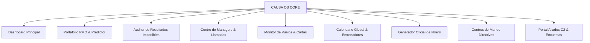

# CAUSA OS • DOCUMENTO FUNDACIONAL Y ARQUITECTURA DEL SISTEMA
**Sistema Operativo y Gobernanza Predictiva de CREAR Poder Sin Límites (CPSL)**  
*Documento Maestro Integral de Arquitectura, Lógica Interna ("Caja Negra") y Alcance Operativo Global*  
**Versión de Plataforma:** Causa OS v3.0.0  
**Fecha de Emisión Oficial:** 8 de Noviembre de 2026  
**Clasificación:** Confidencial / Dirección General & Tecnología CPSL  

---

## 1. DEFINICIÓN Y PROPÓSITO FUNDACIONAL

### 1.1 ¿Qué es Causa OS y para qué fue creado?
**Causa OS** es el sistema operativo institucional, plataforma de comando y núcleo de gobernanza predictiva diseñado específicamente para gestionar, monitorear y auditar la totalidad de las operaciones formativas, logísticas, de talento humano y de liderazgo de **CREAR Poder Sin Límites (CPSL)** en todas sus sedes y países de operación (Perú, Ecuador, México y sedes en expansión).

Fue creado para sustituir la fragmentación operativa tradicional (hojas de cálculo dispersas, reportes manuales desfasados y asimetría de información entre la sala de entrenamiento y la gerencia) por una **Única Fuente de Verdad Inmutable**, reactiva y automatizada en tiempo real.

### 1.2 Antecedentes, Necesidad Operativa y Visión del Sistema
1. **Antecedentes de Fragmentación:** En el modelo operativo previo, cada coordinación de ciclo (Capítulo Uno, Capítulo Dos, Maestría del Juego) y cada sede local mantenía listas aisladas de participantes, estados de asistencia en sala (PFD, SFD, TFD), registros de llamadas de managers y asignaciones de entrenadores. Esto generaba inconsistencias críticas entre lo que ocurría en tarima y lo reportado a Dirección.
2. **La Necesidad Operativa:** La escala de CPSL (con múltiples eventos simultáneos cada fin de semana, cientos de participantes en juego y entrenadores internacionales desplazándose entre países) requería un sistema con capacidad de alerta temprana capaz de anticipar deserciones, descalces de vuelos, faltas de seguros médicos y bloqueos en las metas personales.
3. **Visión:** Consolidar un ecosistema digital gobernado por inteligencia artificial y agentes autónomos que elimine la burocracia ciega, garantice el 100% de coherencia ontológica y empodere a directores, gerentes, coordinadores, managers y aliados a liderar desde la evidencia, la transparencia y la verdad.

### 1.3 Filosofía Subyacente y Objetivos de Impacto
- **Compromiso Irrestricto con la Verdad ("Menos es Más"):** El sistema no maquilla métricas. Una persona en juego está presente o desertora; una meta está aprobada con evidencia o está devuelta con observación. La interfaz prioriza la información esencial de alto valor estratégico sobre la saturación técnica.
- **Ontología y Transformación Personal:** Cada módulo refleja la promesa de valor de CPSL. El seguimiento de los participantes no es un registro frío de CRM, sino una estructura de acompañamiento para el cumplimiento de su palabra y propósito personal.
- **Arquitectura HAR vs. RIs:** Separación estricta entre **Hábitos de Alto Rendimiento (HAR)** (acciones procesales diarias cuantificables) y **Resultados Imposibles (RIs)** (hitos macro disruptivos).
- **Descontinuación de Lenguaje Obsoleto:** Erradicación definitiva de conceptos no institucionales: el rol de apoyo se denomina rigurosamente **"Partner"** (queda terminantemente proscrito el término "sombra"), y el seguimiento de objetivos se denomina exclusivamente **"Resultados Imposibles (RIs)"** (purgando el término "Futuros Imposibles").

---

## 2. DESARROLLO Y ORIGEN

### 2.1 Proceso de Creación, Decisiones de Diseño y Tecnologías Involucradas
Causa OS fue concebido bajo el principio de **alta disponibilidad y resiliencia offline/online**:
- **Frontend SPA de Alto Rendimiento:** Desarrollado con **React 19**, paquetizado con **Vite v8.3.5** y estructurado mediante componentes modulares desacoplados con lazy loading condicional.
- **Backend Serviceless & Base de Datos Reactiva:** Implementado sobre **Google Cloud Platform (GCP)** y **Firebase**:
  - **Cloud Firestore:** Almacén NoSQL distribuido en tiempo real, respaldado por un set de más de 1200 líneas de reglas de seguridad auditadas (`firestore.rules`).
  - **Firebase Authentication:** Gestión federada de identidades con soporte de tokens JWT y control de revocación.
  - **Firebase Cloud Storage:** Resguardo seguro de evidencias fotográficas, contratos y boletos aéreos.
  - **Firebase Hosting:** Distribución global con CDN Edge de baja latencia.
- **Motores Autónomos y Agentes (Backend Daemons):**
  - Scripts en **Node.js ESM** y micro-agentes ejecutados en intervalos programados.
  - Motores en **Python 3** equipados con **PyMuPDF (fitz)** para la disección forense de boletos y pasajes aéreos en formato PDF.
  - Web Scraping automatizado mediante **Puppeteer-Extra Stealth** para la extracción e ingestión de estados del sistema legado IMO / Nodus.

### 2.2 Evolución Cronológica del Sistema
1. **Fase 1 (Causa v1 - 2024/2025):** Plataforma estática inicial de consulta de cronogramas y directorio de contactos en Google Sheets.
2. **Fase 2 (Causa OS 2.0 - Primer Semestre 2026):** Migración a arquitectura SPA, unificación de sedes (Lima, Quito, Cuenca, Guayaquil, CDMX), lanzamiento del primer semáforo de llamadas de managers y monitor de vuelos de entrenadores.
3. **Fase 3 (Causa OS 3.0.0 - Versión Actual):**
   - Despliegue de la suite de Gobernanza de los **3 Resultados Imposibles con Agente Evaluador IA (EMPOR)**.
   - Incorporación del **Predictor Inteligente PMO** y Centinela RRHH.
   - Aislamiento y blindaje del auditor Armando para manejo interno exclusivo.
   - Refactorización del parseador universal de equipos multisede para desglosar tríadas de Maestría (`Equipos #9 · #8 · #7`).
   - Gobernanza de roles unificada y sincronización autónoma 7x día.

---

## 3. ANÁLISIS DE "CAJA NEGRA" (LÓGICA INTERNA Y ALGORITMOS)

Esta sección desglosa los procesos que operan tras bambalinas, garantizando la exactitud de los datos sin intervención humana manual.

### 3.1 Motor de Desconcatenación y Proyección de Equipos (`formatTeam.js`)
- **Problema de Negocio:** En Google Calendar y el Apps Script corporativo, los entrenamientos de Maestría del Juego combinan 3 ciclos consecutivos de egresados, registrándose en una sola cadena sin separadores (`"987"`, `"1098"`, `"11109"`, `"121110"`, `"1009896"`). Sin una lógica dedicada, los sistemas mostraban etiquetas ficticias como *"Equipo #987"*.
- **Algoritmo de Caja Negra:**
  1. Analiza la longitud y monotonicidad de la cadena numérica.
  2. Para 3 dígitos: Si la secuencia es estrictamente decreciente o creciente paso a paso ($d_0 - d_1 = 1$ y $d_1 - d_2 = 1$ como en `987`), descompone la cadena en `['9', '8', '7']`.
  3. Para 4 dígitos: Evalúa combinaciones $2+1+1$ (`1098` $\rightarrow$ `['10', '9', '8']`) o bloques pares estándar de $2+2$ (`2930` $\rightarrow$ `['29', '30']`).
  4. Para 5 dígitos: Si el tercer dígito no es cero, descompone $2+2+1$ (`11109` $\rightarrow$ `['11', '10', '9']`); si los primeros tres dígitos forman un número mayor a 99 (`10098`), descompone en `['100', '98']`.
  5. Para 6 a 9 dígitos: Descompone tríadas de 2 o 3 dígitos (`121110` $\rightarrow$ `['12', '11', '10']`, `126124122` $\rightarrow$ `['126', '124', '122']`).
  6. Preserva valores legítimos de equipos unitarios (`31`, `9`, `100`).

### 3.2 Motor Universal IA de Monitoreo de Vuelos (`sync_drive_vuelos_7xdia.py`)
- **Frecuencia:** Se ejecuta de forma programada 7 veces al día vía GitHub Actions / Cron de servidor.
- **Flujo de Ingesta:**
  1. Conecta con las carpetas maestras de Google Drive donde agencias y entrenadores depositan pasajes (`1i60YXyxRrFP1LxmXUVuHK5eRyeUBzR0r` y `1oi7mUG619dQ2ZVzHzUyO5Xkwti-jgDFl`).
  2. Lee documentos binarios PDF en memoria con PyMuPDF sin dejar archivos temporales inseguros.
  3. Ejecuta expresiones regulares multiformato adaptadas a las plantillas de CheckMyTrip, Sabre, Virtually There, CUV LATAM, Avianca, Copa Airlines y United.
  4. Extrae de forma estructurada: Código de Reserva (PNR), Pasajero, Código de Vuelo, Aeropuerto Origen/Destino, Fecha/Hora exacta y Estado de Emisión.
  5. Cruza las fechas del boleto contra el evento calendarizado del entrenador en Causa OS:
     - Si la llegada es posterior al inicio del entrenamiento, emite **Alerta Roja de Descalce Logístico**.
     - Si el pasaje no incluye retorno o no cuenta con seguro de viaje asociado, emite **Advertencia Operativa**.
  6. Publica el manifiesto sincronizado en `public/vuelos_tracker.json` y en Firestore.

### 3.3 Agente Evaluador IA de Resultados Imposibles (`nodusFIAgent.js`)
- **Regla Estricta:** Todo participante en juego debe contar con exactamente **3 Resultados Imposibles** de estándar superior.
- **Evaluación Ontológica EMPOR:**
  1. **Evidencia:** ¿El RI cuenta con una métrica cuantificable verificable (USD, kilogramos, unidades, fechas límite)?
  2. **Medición:** ¿Existe una línea base y un porcentaje de avance respaldado por el partner asignado?
  3. **Propósito:** ¿Está redactado con la estructura `"Para [en quién me convierto al lograrlo]"`?
  4. **Ontología:** ¿Es una declaración transformacional de quiebre o un mero deseo vago?
- **Salida Automatizada:** Emite un dictamen con sugerencia de ajuste inmediato o aprueba la meta fijando la retroalimentación en el expediente del participante.

### 3.4 Sincronizador Multisede de Asistencia Nodus (IMO Scraping)
- Emplea un spider con fingerprinting protegido (`spiderMaestriaGlobal.mjs` y `spiderMaestriaLima.mjs`) que navega la plataforma IMO/Nodus.
- Extrae la matriz completa de participantes activos en sala para el fin de semana PFD.
- Filtra deserciones, valida que el DNI no esté duplicado entre sedes y consolida un documento inmutable en Firestore (`nodus_futuros_imposibles/latest_partial`).
- Si una sede no tiene corte en vivo, recurre al último snapshot verificado, señalando con transparencia la antigüedad de la lectura en pantalla.

---

## 4. MÓDULOS Y ALCANCE OPERATIVO

El sistema está compuesto por un ecosistema de más de 40 módulos especializados accesibles según el perfil del usuario:

### 4.1 Dashboard Principal (`/home`)
- **Propósito:** Vista consolidada de la jornada operativa para la sede activa o vista global.
- **Componentes:**
  - Semáforo de frescura del calendario (`CalendarFreshness`).
  - Tarjetas de eventos del fin de semana con desglose desconcatenado de equipos.
  - Hotel sede oficial con geolocalización.
  - Entrenadores confirmados y estado de liquidación.
  - Acceso directo al Auditor de Resultados Imposibles (IA), Generador de Flyers y Centro de Managers.

### 4.2 Portafolio PMO • Predictor Inteligente (`/portafolio`)
- **Propósito:** Gobernanza estratégica y analítica predictiva del rendimiento de ciclos formativos.
- **Pestañas:**
  - **Predictor Data Science:** Estimación probabilística de graduación y retención por equipo.
  - **Ciclos Activos:** Monitoreo del flujo de participantes entre C1, C2 y Maestría del Juego.
  - **Capacidad de Recursos:** Saturación y disponibilidad de salones, inventario y staff.
  - **Centinela RRHH:** Monitoreo de rotación de coordinadores y disponibilidad de talento.
  - **Resultados Imposibles (IA):** Tablero de supervisión de cumplimiento de las 3 metas por equipo.
  - **Módulos Nodus (En Vivo):** Inspección de catálogos y endpoints de la plataforma base.
  - **Usuarios Nodus:** Inventario de usuarios sincronizados con contraste de roles.

### 4.3 Auditor de Resultados Imposibles (IA) (`/resultados-imposibles`)
- **Propósito:** Certificación de estándar ontológico para cada participante activo en sala.
- **Funcionalidades:**
  - Semáforo de cumplimiento por equipo (porcentaje de participantes con sus 3 metas aprobadas).
  - Búsqueda instantánea por Nombre, DNI o Equipo.
  - Modal de revisión "Menos es Más": Vista en 3 tarjetas independientes de los RIs del participante, ribbon contextulizador fijado sobre la retroalimentación y opciones de Aprobación o Devolución con Observación.

### 4.4 Centro de Managers & CRM de Llamadas (`/centro-managers`)
- **Propósito:** Gestión del seguimiento telefónico diario de los participantes.
- **Funcionalidades:**
  - Registro de llamadas con estados estandarizados: Contactado, No Contesta, Compromiso de Pago, Deserción en Riesgo, Mensaje WA.
  - Enlace dinámico directo para iniciar chat de WhatsApp preconfigurado con el participante o manager.
  - Historial cronológico de notas de seguimiento por equipo.
  - Matriz de conversión de enrolamiento y confirmación de sentados para sala.

### 4.5 Monitor de Vuelos y Cartas de Invitación (`/vuelos`)
- **Propósito:** Blindaje logístico internacional de entrenadores.
- **Funcionalidades:**
  - Rastreo en tiempo real de boletos aéreos de llegada y retorno.
  - Generador automatizado de Cartas de Invitación Notariadas y Consulares para tránsito migratorio.
  - Auditoría de coincidencia entre fecha del evento y llegada al aeropuerto sede.

### 4.6 Calendario Global y Asignador de Entrenadores (`/team-calendar`, `/asignador-entrenadores`)
- **Propósito:** Programación oficial de aperturas, cierres y entrenamientos para todo el año fiscal.
- **Funcionalidades:**
  - Integración bidireccional con Google Calendar y Google Sheets corporativo.
  - Algoritmo de sugerencia de entrenadores basado en certificaciones de nivel (C1, C2, MJ).
  - Alerta de solapamiento geográfico (evita asignar al mismo entrenador en dos países el mismo fin de semana).
  - Panel de liquidación y honorarios profesionales con control de reversión.

### 4.7 Generador Oficial de Flyers de Graduación (`/generador-flyer`)
- **Propósito:** Creación y exportación de piezas gráficas institucionales para redes sociales y WhatsApp.
- **Capacidades:**
  - Soporte de formatos estándar 1080x1920 (Stories/Estados) y 1080x1080 (Feed).
  - Carga optimizada de fotos de graduados con recorte y máscara circular integrada.
  - Tipografías oficiales CPSL, logos vectoriales de alta resolución y metadatos de sede/equipo.
  - Exportación en PNG de alta calidad sin dependencias externas de diseño.

### 4.8 Centros de Mando Directivos
- **Andrés Gómez (`/andres-command-center`):** Supervisión de directores de sede, coordinadores C1/C2/MJ, metas de expansión y auditoría ontológica superior.
- **Elizabeth (`/elizabeth-dashboard`):** Gobernanza institucional de sedes, calidad de servicio y seguimiento de comités.
- **CFO Workspace (`/cfo`):** Control presupuestario, flujo de caja por evento, costos de salón y liquidaciones de entrenadores.
- **Legal Command Center (`/legal`):** Contratos de confidencialidad (NDA), acuerdos de exención de responsabilidad civil y monitoreo de personería jurídica en cada país.

### 4.9 Portal de Aliados C2 (`/aliados-c2`)
- **Propósito:** Plataforma de acreditación, encuestas y material de estudio para aliados activos en sala.
- **Capacidades:**
  - Encuesta de acreditación obligatoria con firma de compromiso y confidencialidad.
  - Registro de dispositivos y monitoreo de conexiones activas en tiempo real.
  - Acceso controlado a la Guía Oficial de Aliados con trazabilidad de lectura por módulo.

---

## 5. POLÍTICAS DE SEGURIDAD, USUARIOS Y ROLES

### 5.1 Matriz de Roles y Niveles de Acceso (RBAC)
Causa OS implementa un control de acceso basado en roles con validación cruzada en el cliente ([`RoleRoute.jsx`](file:///Users/joseluissanchezmoreno/.copilot/repos/copilot-worktrees/SO-AR/crearpodersinlimitesperu-cmd-literate-dollop/src/components/RoleRoute.jsx)), en la capa de servicios ([`permissions.js`](file:///Users/joseluissanchezmoreno/.copilot/repos/copilot-worktrees/SO-AR/crearpodersinlimitesperu-cmd-literate-dollop/src/utils/permissions.js)) y en el backend ([`firestore.rules`](file:///Users/joseluissanchezmoreno/.copilot/repos/copilot-worktrees/SO-AR/crearpodersinlimitesperu-cmd-literate-dollop/firestore.rules)).

| Rol Institucional | Código de Sistema | Alcance de Datos | Capacidades Principales |
| :--- | :--- | :--- | :--- |
| **Super Administrador** | `superadmin` | Global (Todas las sedes) | Acceso total, bypass de auditoría técnica, asignación de roles y configuración de plataforma. |
| **Socio Fundador / Dirección** | `socio_fundador`, `andres_gomez` | Global | Supervisión estratégica, auditoría ontológica, reportes PMO y finanzas consolidadas. |
| **Gerente de Operaciones / Sede** | `gerente`, `director_sede` | Sede asignada | Aprobación de presupuestos, supervisión de salas, control de managers y asignación local. |
| **Coordinador de Ciclo (C1 / C2 / MJ)** | `coordinador_c1`, `coordinador_c2`, `coordinador_mj`, `coord_c1_c2` | Sede / Ciclo | Gestión de salas, asistencia de participantes, revisión y aprobación de RIs, control de staff. |
| **Quantum Team / Capitán** | `qt`, `capitan` | Sede / Equipo | Monitoreo de cumplimiento de equipo, consulta de cronogramas y trazabilidad de metas. |
| **Manager de Equipo** | `manager_general`, `manager_equipo` | Equipo asignado | Registro de llamadas, seguimiento de compromisos, contacto WA con participantes. |
| **Entrenador / Coach** | `entrenador`, `trainer_shadow` | Sus entrenamientos | Consulta de cronogramas, itinerarios de vuelo, cartas migratorias y acuerdos de sala. |
| **Aliado Acreditado** | `aliado`, `aliado_c2` | Individual / Guía C2 | Acceso a manuales operativos, encuesta de acreditación y checklist personal. |
| **Auditor Interno** | `auditor`, `auditor_armando` | Restringido / Causa OS | Certificación de auditoría de arquitectura y validación de reglas de negocio inmutables. |

### 5.2 Protección de Rutas y Prevención de Desalineaciones
1. **Verificación Estricta en Enrutador:** Cada ruta en `App.jsx` está envuelta en un componente `<RoleRoute allowedRoles={[...]}>`. Si un usuario intenta acceder a un módulo sin permiso explícito, el sistema lo redirige de forma segura a `/home` o muestra una pantalla de acceso denegado sin exponer datos sensibles.
2. **Paridad Total con Menús y Buscador:** Existe una suite de pruebas automatizadas (`tests/ui-routes-buttons-integrity.test.mjs`) que verifica en cada build que no exista ningún botón visible en la interfaz para un rol cuya ruta esté bloqueada en el enrutador.
3. **Bypass Legítimo de SuperAdmin:** El rol `superadmin` posee autorización universal en la plataforma para fines de soporte y emergencia, excepto cuando activa voluntariamente el modo de simulación de rol en la barra superior.

### 5.3 Reglas de Seguridad en Cloud Firestore (`firestore.rules`)
- **Principio de Menor Privilegio:** Ninguna colección permite lectura o escritura abierta sin autenticación verificada.
- **Colecciones Sensibles Protegidas:**
  - `nodus_futuros_imposibles`: Solo modificable por procesos de backend autenticados y coordinadores/superadmins acreditados.
  - `users`: Los usuarios pueden leer y editar únicamente su propio perfil (`request.auth.uid == userId`); la alteración de roles requiere privilegios de `superadmin`.
  - `vuelos` y `cartas_invitacion`: Lectura restringida al entrenador titular y al equipo directivo; escritura restringida a logística y superadmin.
- **Trazabilidad Inmutable:** Se prohíbe el borrado físico (`delete`) en colecciones de auditoría, llamadas y registros de metas; los registros inactivos se gestionan mediante banderas de estado (`deleted: true` o `activo: false`).

---

*Causa OS • Tecnología y Transformación al Servicio de la Grandeza Humana.*  
*CREAR Poder Sin Límites — Todos los derechos reservados © 2026.*
